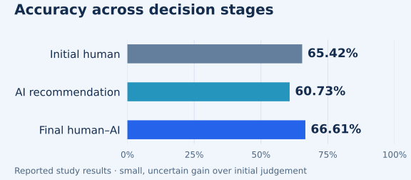
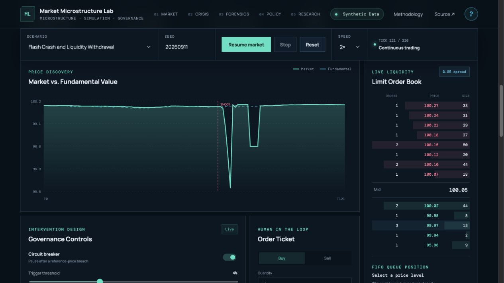
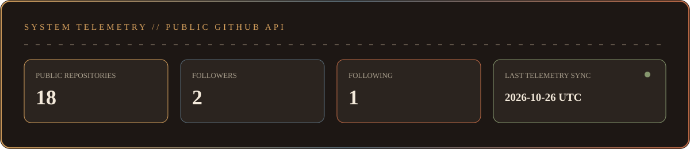

# Jithu Vathiath Biju

**AI / ML engineering · Software engineering · Financial analytics**

I’m an AI researcher and engineer building tools to evaluate **human–AI decisions, financial risk and AI assurance**. I turn research questions into tested software, with clear evaluation methods and documented limitations.

[Selected work](#selected-work) · [Research](#humanai-collaboration) · [LinkedIn](https://in.linkedin.com/in/jithu-v-biju) · [Email](mailto:jithuvathiath@gmail.com)

Interested in **AI/ML engineer, software development engineer and analyst roles**, and research collaborations across responsible AI and financial technology.

## Selected work

### Human–AI collaboration

**When should people accept or challenge AI advice?** My Warwick research combines decision analysis and human-coded qualitative evidence to examine AI-assisted lending decisions.

Across **22 participants and 2,200 decision rows**, final human–AI accuracy was **66.61%**, compared with **65.42%** for initial human judgement and **60.73%** for the AI recommendation. The **1.19 percentage-point** improvement over initial judgement was small and uncertain.

Of **700 initial disagreements**, **60%** involved appropriate acceptance of correct AI advice or appropriate resistance to incorrect advice. These are experimental sample findings; the public repository shares code and documentation, while participant-level data remain restricted.

`Python` `Jupyter` `CatBoost` `SHAP` · [Research & methodology](https://github.com/JithuVathiath/human-ai-loan-collaboration-analysis) · [Public reproducibility](https://github.com/JithuVathiath/human-ai-loan-collaboration-analysis/blob/main/docs/public_reproducibility.md)

### SBA credit-risk benchmark

**Can a model identify five-year charge-off risk on future loan vintages?** I built a reproducible benchmark across **514,825 eligible SBA 7(a) loans**, using time-based partitions, leakage controls and probability calibration.

CatBoost achieved **0.385 test PR-AUC**, against a **0.040 no-skill baseline**, on the FY2018–FY2020 test cohort. Its test PR-AUC bootstrap interval was **0.376–0.398**. Model selection used validation PR-AUC before the test set was scored; the results concern already-approved loans.

`Python` `scikit-learn` `CatBoost` `Docker` · [Code & results](https://github.com/JithuVathiath/credit-risk-ml-benchmark) · [Evaluation protocol](https://github.com/JithuVathiath/credit-risk-ml-benchmark/blob/main/docs/evaluation-protocol.md) · [Calibration plots](https://github.com/JithuVathiath/credit-risk-ml-benchmark/blob/main/reports/figures/calibration_curves.png)

### Market microstructure lab

**How do market rules change the impact of a liquidity shock?** I built a browser laboratory with a Rust/WebAssembly exchange core, inspectable trading agents, event replay and paired policy experiments.

Run the same scenario and seed under different policies, inspect the order book and agent decisions, then export a replay and incident report. The lab uses **synthetic educational simulations**; its outputs describe the model rather than real-market performance.

*Actual simulation output: a liquidity shock, its price path and the order book. Launch the lab to inspect the event sequence and compare policies.*

`Rust` `WebAssembly` `TypeScript` `React` · **[Launch the lab →](https://jithuvathiath.github.io/market-microstructure-crisis-lab/)** · [Source & architecture](https://github.com/JithuVathiath/market-microstructure-crisis-lab)

<strong>More engineering and research</strong>

**AI assurance & data systems**

- [AI Assurance Case Stress Lab](https://github.com/JithuVathiath/ai-assurance-case-stress-lab) — Connects assurance claims to evidence and tests approvals under governance shocks. `TypeScript` `Node.js`
- [Continuous AI Assurance](https://github.com/JithuVathiath/ai-governance-continuous-assurance) — Tracks control drift and records evidence in a tamper-evident audit ledger.
- [SQL Market Settlement Forensics](https://github.com/JithuVathiath/sql-market-settlement-forensics) — Builds traceable ingestion and warehouse analysis for SEC fails-to-deliver data. `PostgreSQL` `Go`
- [Strata Search Engine](https://github.com/JithuVathiath/strata-search-engine) — Implements ranked retrieval, positional indexes and reproducible benchmarks. `C++20`

**Simulation & applied machine learning**

- [Supply Network Resilience Lab](https://github.com/JithuVathiath/supply-network-resilience-lab) — Studies network disruption and resilience investment with Monte Carlo simulation. `Swift`
- [Quantum Heart-Disease Ensemble](https://github.com/JithuVathiath/quantum-heart-disease-ensemble) — Compares classical and quantum methods with leakage controls and explicit limits on advantage claims.
- [Plant-Disease Deep Learning](https://github.com/JithuVathiath/parallel-plant-disease-deep-learning) — Evaluates ResNet-18 with calibration and measured parallel scaling.
- [Lok Sabha Electoral Analytics](https://github.com/JithuVathiath/lok-sabha-2024-electoral-analytics) — Reconciles election sources and examines seat–vote relationships.
- [Smart File Organizer](https://github.com/JithuVathiath/smart-file-organizer) — Automates local organisation with previews, conflict handling and undo.

## Skills demonstrated in public work

- **Machine learning:** Python, scikit-learn, CatBoost, calibration and temporal validation — [credit-risk benchmark](https://github.com/JithuVathiath/credit-risk-ml-benchmark).
- **AI research:** mixed methods, reliance analysis, uncertainty and SHAP — [human–AI study](https://github.com/JithuVathiath/human-ai-loan-collaboration-analysis).
- **Software engineering:** Rust, WebAssembly, TypeScript and React — [market lab](https://github.com/JithuVathiath/market-microstructure-crisis-lab); C++20 and information retrieval — [Strata](https://github.com/JithuVathiath/strata-search-engine).
- **Data engineering:** SQL, PostgreSQL, Go and data-quality contracts — [settlement forensics](https://github.com/JithuVathiath/sql-market-settlement-forensics).
- **Delivery & reproducibility:** Docker, GitHub Actions, automated tests and experiment protocols — [benchmark workflow](https://github.com/JithuVathiath/credit-risk-ml-benchmark#reproduce-the-results).

## Current focus

My next research and engineering priorities build on these public systems:

- **Market simulation:** build paired experiments for mid-simulation branching and reopening auctions — [documented roadmap](https://github.com/JithuVathiath/market-microstructure-crisis-lab#roadmap).
- **Financial ML:** produce a vintage-level robustness comparison using the published calibration and drift reports — [current evidence](https://github.com/JithuVathiath/credit-risk-ml-benchmark#results-and-explanations).
- **AI assurance:** extend the catalogue of evidence-linked stress scenarios for human oversight and approvals — [assurance lab](https://github.com/JithuVathiath/ai-assurance-case-stress-lab).

## Education & publication

**Warwick Business School — MSc Financial Technology** 
2025–2026 · Graduation scheduled for **January 2027** 
Research: human–AI collaboration, responsible AI and lending decisions.

**SRM Institute of Science and Technology — B.Tech, Computer Science and Engineering** 
2021–2025 · CGPA **8.65 / 10**

Co-author, **“Prediction of Cardiac Disease Using Quantum Enhanced Ensemble Learning Approach”**, IEEE ICITIIT 2025. [Read the publication](https://doi.org/10.1109/ICITIIT64777.2025.11041018).

## Let’s connect

For AI/ML engineering, software development, analyst opportunities or research collaboration: **[jithuvathiath@gmail.com](mailto:jithuvathiath@gmail.com)** · [LinkedIn](https://in.linkedin.com/in/jithu-v-biju) · [All repositories](https://github.com/JithuVathiath?tab=repositories).

GitHub activity & a little personality

<picture>
  <source media="(prefers-color-scheme: dark)" srcset="https://raw.githubusercontent.com/JithuVathiath/JithuVathiath/output/pacman-contribution-graph-dark.svg" />
  <source media="(prefers-color-scheme: light)" srcset="https://raw.githubusercontent.com/JithuVathiath/JithuVathiath/output/pacman-contribution-graph.svg" />
  
</picture>

Repository statistics refresh weekly; the contribution animation refreshes daily. [GitHub’s native contribution history](https://github.com/JithuVathiath) is the primary activity record. [Instagram](https://www.instagram.com/jithu_v_18/).

